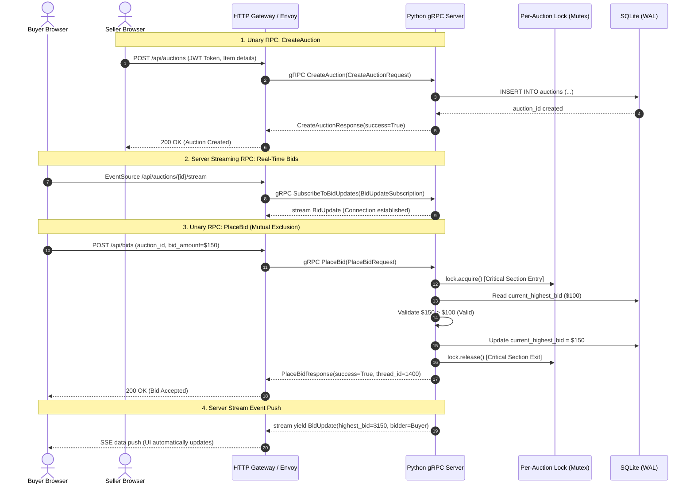

# Online Auction System – Distributed Computing Project

A complete, production-grade **Online Auction System** built using **React, Python, and gRPC (Remote Procedure Call)**, engineered to demonstrate core Distributed Computing concepts including:
- **Remote Procedure Call (RPC)** with Unary and Server-Streaming communication
- **Concurrency** via Python `ThreadPoolExecutor` handling simultaneous clients
- **Synchronization & Mutual Exclusion** via fine-grained per-auction `threading.Lock`
- **Race Condition Analysis** with reproducible simulations with and without locks

---

## 1. System Architecture

```
+-------------------------------------------------------------------------+
|                              Web Browser                                |
|  React 19 + Vite + Tailwind CSS + Real-time Server-Sent Streaming       |
+-------------------------------------------------------------------------+
                                     |
                          HTTP/JSON / gRPC-Web
                                     v
+------------------------------------+------------------------------------+
|            Option A: Gateway       |        Option B: Envoy Proxy       |
|    Threaded HTTP/gRPC Bridge       |          gRPC-Web Filter           |
|          (Port: 8000)              |            (Port: 8080)            |
+------------------------------------+------------------------------------+
                                     |
                          Native gRPC (HTTP/2)
                                     v
+-------------------------------------------------------------------------+
|                         Python gRPC Server                              |
|           ThreadPoolExecutor (10 Concurrent Worker Threads)             |
|                            (Port: 50051)                                |
+-------------------------------------------------------------------------+
                                     |
+------------------------------------+------------------------------------+
|  AuctionServiceServicer (RPC Layer)| BidUpdateStreamingService (Stream) |
+------------------------------------+------------------------------------+
                                     |
                                     v
+-------------------------------------------------------------------------+
|                             Auction Manager                             |
|          Separates Transport/RPC Layer from Business Logic              |
+-------------------------------------------------------------------------+
                                     |
                                     v
+-------------------------------------------------------------------------+
|                  Synchronization & Mutual Exclusion Layer               |
|      Per-Auction Locks (threading.Lock) for Atomic Read-Validate-Update |
+-------------------------------------------------------------------------+
                                     |
                                     v
+-------------------------------------------------------------------------+
|                           SQLite Database Layer                         |
|           WAL Mode (Write-Ahead Logging) + Thread-Local Connections     |
+-------------------------------------------------------------------------+
```

---

## 2. Distributed Computing Concepts Demonstrated

### A. Remote Procedure Calls (RPC)
- Defined contract in `backend/proto/auction.proto` with Protocol Buffers serialization.
- Python server stubs generated via `grpc_tools.protoc`.
- **RPC Types Implemented**:
  | RPC Type | Methods | Functionality |
  |---|---|---|
  | **Unary RPC** | `RegisterUser`, `Login` | User authentication & session generation |
  | **Unary RPC** | `CreateAuction`, `CloseAuction` | Seller lifecycle management |
  | **Unary RPC** | `PlaceBid`, `GetHighestBid` | Synchronized bidding operations |
  | **Unary RPC** | `GetActiveAuctions`, `GetAuctionDetail` | Auction discovery and queries |
  | **Unary RPC** | `GetBidHistory`, `GetUserBids` | Bid ledger auditing |
  | **Unary RPC** | `DemoRaceCondition` | On-demand concurrency testing |
  | **Server Streaming RPC** | `SubscribeToBidUpdates` | Push-based real-time bid updates |

### B. Concurrency
- Python gRPC server runs with `concurrent.futures.ThreadPoolExecutor(max_workers=10)`.
- Concurrent requests are processed by independent threads.
- Server logs worker `Thread ID` and timestamps on every RPC execution.

### C. Synchronization and Mutual Exclusion
- **Critical Section**: Reading the current highest bid, validating that `new_bid > current_highest_bid`, and persisting the new highest bid to the ledger.
- **Mutual Exclusion**: Protected by fine-grained per-auction `threading.Lock`.
- Double-checked locking ensures high concurrency across different auctions while strictly serializing bids on the same auction item.

### D. Race Conditions (With vs. Without Synchronization)
Two reproducible demonstration modes are provided in `backend/concurrency/`:
1. **Without Locks (`race_condition_demo.py`)**: Multiple threads read stale state simultaneously before writing. A lower bid can overwrite a higher bid.
2. **With Locks (`synchronized_demo.py`)**: Atomic lock acquisition enforces strict serialization, ensuring consistent state.

---

## 3. Project Directory Structure

```
DC/
├── .gitignore
├── README.md
├── backend/
│   ├── proto/
│   │   └── auction.proto               # Protocol Buffer service definition
│   ├── generated/
│   │   ├── auction_pb2.py              # Protobuf serialization classes
│   │   └── auction_pb2_grpc.py         # gRPC client & server stubs
│   ├── database/
│   │   ├── __init__.py
│   │   └── db.py                       # Thread-safe SQLite layer with WAL
│   ├── services/
│   │   ├── __init__.py
│   │   ├── auth_service.py             # User authentication logic
│   │   └── bidding_service.py          # Synchronized bidding & stream dispatch
│   ├── server/
│   │   ├── __init__.py
│   │   ├── auction_manager.py          # Core business orchestration
│   │   ├── auction_service.py          # gRPC Servicer implementation
│   │   ├── server.py                   # Main gRPC server entry point
│   │   └── gateway.py                  # HTTP/gRPC bridge for browser access
│   ├── concurrency/
│   │   ├── __init__.py
│   │   ├── race_condition_demo.py      # Standalone race condition runner
│   │   ├── synchronized_demo.py        # Standalone mutual exclusion runner
│   │   └── concurrent_bid_test.py      # Multi-threaded simultaneous gRPC test
│   └── requirements.txt                # Python backend dependencies
├── frontend/
│   ├── package.json                    # React + Vite dependencies
│   ├── vite.config.js                  # Vite bundler configuration
│   ├── index.html                      # HTML entry with Inter/JetBrains fonts
│   └── src/
│       ├── main.jsx                    # React root mounter
│       ├── App.jsx                     # Route architecture & navigation
│       ├── index.css                   # Custom design system & animations
│       ├── context/
│       │   └── AuthContext.jsx         # Authentication & role state
│       ├── hooks/
│       │   └── useAuctions.js          # Custom data fetching & stream hooks
│       ├── services/
│       │   └── api.js                  # gRPC-Web gateway client
│       ├── components/
│       │   ├── Navbar.jsx              # Responsive header with role indicators
│       │   ├── ProtectedRoute.jsx      # Role-based route guard
│       │   ├── AuctionCard.jsx         # Auction item card with countdown
│       │   └── Toast.jsx               # Floating notifications
│       └── pages/
│           ├── LoginPage.jsx           # Sign-in page
│           ├── RegisterPage.jsx        # Registration with Buyer/Seller roles
│           ├── BuyerDashboard.jsx      # Auction discovery & search
│           ├── SellerDashboard.jsx     # Seller auction management
│           ├── CreateAuctionPage.jsx   # Create new auction listing
│           ├── AuctionDetailPage.jsx   # Live auction page with bid placement
│           ├── MyBidsPage.jsx          # Personal bid audit ledger
│           └── DemoPage.jsx            # Interactive DC concepts lab
└── envoy/
    ├── envoy.yaml                      # Envoy gRPC-Web proxy configuration
    └── Dockerfile                      # Envoy container setup
```

---

## 4. Setup and Installation Instructions

### Prerequisites
- **Python 3.10+**
- **Node.js 18+ & npm**
- **Docker** (Optional, for running Envoy proxy)

---

### Step 1: Set Up Python Backend

#### Windows (PowerShell)
```powershell
cd C:\repo\DC\backend

# Create virtual environment
python -m venv .venv

# Activate virtual environment
.\.venv\Scripts\Activate.ps1

# Install dependencies
pip install -r requirements.txt

# (Optional) Recompile proto if modifying auction.proto:
python -m grpc_tools.protoc -I proto --python_out=generated --grpc_python_out=generated proto/auction.proto
```

#### Linux / macOS (Bash)
```bash
cd backend
python3 -m venv .venv
source .venv/bin/activate
pip install -r requirements.txt
python3 -m grpc_tools.protoc -I proto --python_out=generated --grpc_python_out=generated proto/auction.proto
```

---

### Step 2: Set Up React Frontend

```bash
cd ../frontend

# Install dependencies
npm install

# Build for validation (optional)
npm run build
```

---

## 5. Running the Application

To run the complete system, start the components in separate terminal windows:

### Terminal 1: Python gRPC Server (Port 50051)
```powershell
# Windows
cd C:\repo\DC\backend
.\.venv\Scripts\python.exe server\server.py

# Linux
cd backend && source .venv/bin/activate
python3 server/server.py
```
*Output:*
```
[INIT] Initializing database...
[INIT] Creating gRPC server with ThreadPoolExecutor (max_workers=10)...
[READY] gRPC server listening on port 50051
```

### Terminal 2: HTTP Gateway / gRPC Bridge (Port 8000)
```powershell
# Windows
cd C:\repo\DC\backend
.\.venv\Scripts\python.exe server\gateway.py

# Linux
cd backend && source .venv/bin/activate
python3 server/gateway.py
```
*Output:*
```
[GATEWAY] HTTP gateway listening on port 8000
[GATEWAY] Proxying to gRPC server at localhost:50051
```

*(Alternative: If using Envoy Proxy instead of the Python Gateway, run `docker build -t envoy-grpc-web envoy/` and `docker run -p 8080:8080 -p 9901:9901 envoy-grpc-web`)*.

### Terminal 3: React Frontend (Port 3000)
```bash
cd C:\repo\DC\frontend
npm run dev
```
Open **`http://localhost:3000`** in your browser.

---

## 6. Running Distributed Computing Demonstrations

### 1. Standalone Race Condition Demo (Without Locks)
Simulates 10 simultaneous threads without synchronization:
```powershell
cd C:\repo\DC\backend
.\.venv\Scripts\python.exe concurrency\race_condition_demo.py
```
*Sample Output:*
```
[Thread 18404] Bidder-9 attempting bid $200.00
[Thread 3616]  Bidder-5 reads highest bid: $100.00
[Thread 18404] Bidder-9 reads highest bid: $100.00
[Thread 18404] Bidder-9 bid $200.00 ACCEPTED (was $100.00) [!] NO LOCK
[Thread 25316] Bidder-2 bid $130.00 ACCEPTED (was $100.00) [!] NO LOCK
------------------------------------------------------------
  RESULTS
------------------------------------------------------------
  Bids attempted: 10
  Bids accepted:  10
  Expected highest bid: $200.00
  Actual highest bid:   $130.00
  Race condition detected: YES [!]
```

### 2. Standalone Mutual Exclusion Demo (With Locks)
Protects the critical section with `threading.Lock`:
```powershell
cd C:\repo\DC\backend
.\.venv\Scripts\python.exe concurrency\synchronized_demo.py
```
*Sample Output:*
```
[Thread 6416] Bidder-9 ACQUIRED lock
[Thread 6416] Bidder-9 reads highest bid: $100.00
[Thread 6416] Bidder-9 bid $200.00 ACCEPTED (was $100.00)
[Thread 6416] Bidder-9 RELEASED lock
[Thread 1400] Bidder-0 ACQUIRED lock
[Thread 1400] Bidder-0 reads highest bid: $200.00
[Thread 1400] Bidder-0 bid $110.00 REJECTED (current: $200.00)
[Thread 1400] Bidder-0 RELEASED lock
------------------------------------------------------------
  RESULTS
------------------------------------------------------------
  Bids attempted: 10
  Bids accepted:  1
  Expected highest bid: $200.00
  Actual highest bid:   $200.00
  Race condition detected: NO [OK]
```

### 3. Multi-Threaded Concurrent Bidding gRPC Test
Sends real simultaneous gRPC requests across threads against the active gRPC server:
```powershell
cd C:\repo\DC\backend
.\.venv\Scripts\python.exe concurrency\concurrent_bid_test.py
```
*Sample Output:*
```
--- Sending 5 simultaneous bids ---
[Bidder-4] [ACCEPTED] - $225.00 | Server thread: 14220 | Highest: $225.00
[Bidder-0] [REJECTED] - $125.00 | Server thread: 9812 | Highest: $225.00
Expected highest bid: $225.00
Actual highest bid:   $225.00
[PASSED] Synchronization is working correctly!
```

### 4. Interactive Browser Lab
Navigate to **`http://localhost:3000/demo`** in the React app to trigger live concurrent test simulations directly through the web UI and inspect live thread execution logs.

---

## 7. RPC Sequence Diagram



---

## 8. Summary of Features
- **Authentication**: JWT token validation, buyer and seller roles, protected route guards.
- **Buyer Experience**: Live auction exploration, keyword search, instantaneous bid validation, personal bid history, real-time streaming updates.
- **Seller Experience**: Auction listing creation, custom starting price and duration, auction termination, winner calculation.
- **Distributed Computing Focus**: Thread pool logging, fine-grained mutual exclusion, clear terminal logs demonstrating race conditions.
